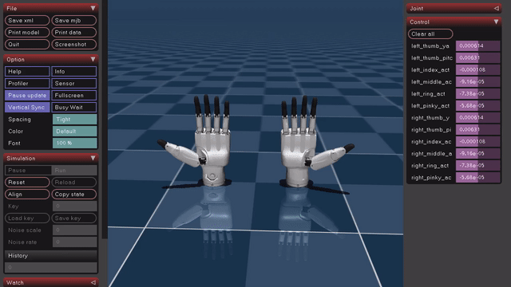

# Inspire hand RH56DFTP-2L

> Note: The MuJoCo XML files in this repository are customized versions created from URDF sources.

This project provides a MuJoCo simulation for the `Inspire hand RH56DFTP-2L` model.



## Overview
- Includes Inspire Hand model files (URDF/XML/OBJ) and an example control script.
- Mesh files are organized into separate `collision/` and `visual/` folders.
- The example script applies PD control to finger joints and runs a looping trajectory.

## Project Structure
- `Inspire_hand/`
  - `urdf/`: URDF source files
    - `inspire_hand_right.urdf`
  - `xml/`: MuJoCo XML files
    - `scene.xml`: Main simulation scene
    - `inspire_hand_right.xml`: Right-hand model definition
  - `collision/`: Collision mesh OBJ files
  - `visual/`: Visual mesh OBJ files
  - `xml/material.mtl`: Material information
- `example/`
  - `control_inspire_hand.py`: MuJoCo viewer-based control example

## Grasp simulation (`hand_sim/`)
Emulates the real hand's register interface (ANGLE_SET / FORCE_SET / SPEED_SET in,
ANGLE_ACT / FORCE_ACT / CURRENT / STATUS out) and lets the hand grasp the VEGABAR sensors.
Run all commands from this `simulation/` folder:

```bash
../venv/bin/pip install -r requirements.txt
../venv/bin/python -m hand_sim.assets      # once: CAD STL -> objects/<id>/ (metres, convex parts)
../venv/bin/mjpython -m hand_sim.run       # viewer; type `help` in the terminal for commands
```

On macOS the viewer must be started with `mjpython`. Typical session: `obj vegabar_38`, `close`,
`release`, `status`, `open`, `attach`.

## URDF Source
- URDF origin/reference: https://github.com/dexsuite/dex-urdf/tree/main?tab=readme-ov-file

## License & Attribution
- This repository includes customized MuJoCo XML files derived from external URDF assets.
- Source repository: https://github.com/dexsuite/dex-urdf
- For Inspire Hand assets, please follow the license noted in the source repository's Robot Source table (Inspire Hand: CC BY-NC-SA 4.0).
- Retain attribution to original authors/source when redistributing modified files.

## Requirements
- Python 3.9+
- MuJoCo Python package
- NumPy

## Installation
```bash
pip install mujoco numpy
```

## Run
From the project root, run the example with:

```bash
python example/control_inspire_hand.py
```

When executed, the viewer opens and finger joints move repeatedly within their configured ranges.

Also, you can "Pause/Resume" the simulator using "Space bar"

## Notes
- You can check the controlled joints in `ACTUATED_JOINTS` in `control_inspire_hand.py`.
- Control gains can be adjusted with `KP_SINGLE_HAND` and `KD_SINGLE_HAND`.

## Author
- **Euncheol Im** - euncheol.im@kist.re.kr